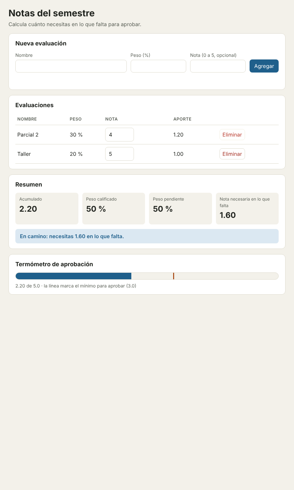

# Entrega · Laboratorio MVC · Notas del semestre

**Equipo:** Trabajo individual  
**Integrantes:** Luis Fernando Usuga Higuita  
**Repositorio:** _(pega aquí el enlace público de tu repositorio de GitHub)_

---

## 1. Mapa de responsabilidades (Parte 1)

| # | Fragmento | Rol(es) | ¿Por qué? |
|---|---|---|---|
| 1 | `var n = document.getElementById('nombre').value.trim();` | **V** | Lee lo que el usuario escribió en un campo de la pantalla. Solo toca el DOM. (El `trim()` ya sería una regla, pero aquí solo limpia el texto de entrada.) |
| 2 | `if (isNaN(p) \|\| p < 1 \|\| p > 100) { err.textContent = 'El peso debe estar entre 1 y 100.'; return; }` | **Mezcla: M + V** | La regla (el peso va de 1 a 100) es del Modelo, pero en la misma línea se escribe el error en la pantalla y se corta el flujo, que es de la Vista y del Controlador. |
| 3 | `if (total + p > 100) { err.textContent = '...'; return; }` | **Mezcla: M + V** | Misma situación: la regla de que los pesos no pasen de 100 % es de negocio, y aquí está pegada al `textContent` del error. |
| 4 | `evals.push({ id: sig++, nombre: n, peso: p, nota: nota });` | **M** | Crea la evaluación, le asigna el id y la agrega a los datos. Es estado del negocio puro. |
| 5 | `localStorage.setItem('notas.v1', JSON.stringify(evals));` | **M** (almacén) | Guardar datos. No es de la pantalla ni de los eventos; en MVC lo hace el Modelo a través de un almacén que recibe. |
| 6 | `document.getElementById('nombre').value = '';` | **V** | Vaciar un campo de formulario es puro dibujo. El Controlador solo debería pedir "limpia el formulario". |
| 7 | `'<input ... onchange="ponerNota(' + e.id + ', this.value)">'` | **Mezcla: V + C** | Arma HTML con texto (V) y a la vez enchufa el evento `onchange` dentro de ese mismo texto (C). Pantalla y reacción al usuario quedan fundidas. |
| 8 | `nec = Math.ceil(nec * 100 - 1e-9) / 100;` | **M** | Es el redondeo de la nota necesaria hacia arriba. Es cálculo del negocio y no debería estar dentro de la función que pinta. |
| 9 | `if (acum + 1e-9 >= 3.0) { txt = '¡Aprobado! ...'; cls = 'ok'; }` | **Mezcla: M + V** | Decidir si está aprobado es regla (M), pero en la misma línea se escoge el texto y la clase CSS (V). |
| 10 | `document.getElementById('tabla').innerHTML = filas;` | **V** | Dibuja la tabla en el DOM. Además usa `innerHTML`, así que el nombre del usuario se interpreta como HTML. |
| 11 | `function borrar(id) { ...splice...; localStorage.setItem(...); pintar(); }` | **Mezcla: C + M + V** | Reacciona al clic (C), modifica los datos y guarda (M) y redibuja (V). Una sola función hace los tres roles. |
| 12 | `(e.peso * e.nota / 100).toFixed(2)` | **Mezcla: M + V** | `peso × nota ÷ 100` es la fórmula del aporte (M) y `toFixed(2)` es solo el formato para mostrarlo (V). Dentro de la pantalla, la fórmula queda duplicada con el acumulado. |

## 2. Olores del espagueti (Parte 1)

| Olor | Consecuencia | Dónde se arregla (M, V o C) |
|---|---|---|
| **Variables globales** (`evals`, `sig`) y funciones sueltas que las cambian desde cualquier lado | Cualquier función puede dañar los datos sin pasar por las reglas. Cuando el archivo crece, ya nadie sabe quién cambió qué. | **M**: el estado queda privado (`#evaluaciones`) y solo se cambia con `agregar`, `calificar` y `eliminar`. |
| **La misma regla escrita en dos funciones**: el rango de la nota 0–5 está en `agregar` y también en `ponerNota` | Si mañana el rango cambia hay que acordarse de editar los dos sitios; si olvido uno, la app se vuelve inconsistente. | **M**: una sola validación privada (`#validarNota`) que reutilizan `agregar` y `calificar`. |
| **Valores «mágicos» repetidos**: `3.0` aparece en tres lugares (el texto del encabezado, el cálculo de `nec` y la comparación del estado), y `4.0`, `5.0` y `1e-9` están sueltos | Al cambiar la nota mínima de 3.0 a 3.5 hay que buscar con Ctrl+F; el que se olvide deja la app diciendo cosas distintas en distintos sitios. | **M**: constantes con nombre (`NOTA_MINIMA`, `NOTA_MAXIMA`, `UMBRAL_RIESGO`, `EPS`). |
| **HTML armado con texto y `innerHTML`** con datos del usuario | Es un agujero de seguridad (XSS): un nombre como `<b>hola</b>` se interpreta como HTML. Además las comillas dentro del string hacen el código frágil. | **V**: `document.createElement` y `textContent`. |
| **Funciones que hacen tres cosas a la vez** (`borrar`, `ponerNota`, `agregar`: leen, validan, guardan y pintan) | Cada función es larga, difícil de leer y no se puede reutilizar ni probar por partes. Un cambio pequeño obliga a revisar todo. | **C** reparte el trabajo (leer → ordenar → reaccionar); **M** valida y guarda; **V** pinta. |
| **Almacenamiento disperso**: `localStorage` se llama desde tres funciones distintas, y la clave `'notas.v1'` se repite | Cambiar el lugar donde se guardan los datos (otra clave, el servidor, la sesión) obliga a tocar varias funciones. | **M** + almacén: el Modelo solo conoce `cargar()` y `guardar()`; el almacén concreto se elige en `main.js`. |
| **Imposible de probar sin navegador**: las reglas están mezcladas con `document` y `localStorage` | Para comprobar que «los pesos suman a lo sumo 100» hay que abrir la página y hacerlo a mano cada vez. No se puede automatizar. | **M** puro: sin DOM, se prueba con `npm run test:modelo` en milisegundos. |

**Los tres experimentos de la Parte 1**

- *El cambio de regla:* en `espagueti.html` tuve que tocar **3 lugares** donde aparece `3.0` (el texto del encabezado y dos en `pintar`). Si me olvido de uno, la pantalla dice una cosa y calcula otra. En MVC es una constante.
- *El nombre raro:* al escribir `<b>hola</b>` como nombre, la tabla muestra «hola» en **negrita** y no el texto que escribí. Pasa porque la tabla se arma con `innerHTML`, así que el navegador interpreta el nombre como HTML.
- *La prueba imposible:* no, no puedo comprobar «los pesos suman a lo sumo 100» sin abrir el navegador, porque esa regla vive dentro de `agregar()`, que lee del DOM (`document.getElementById`) y escribe errores en la pantalla. No hay forma de llamarla con datos y mirar el resultado.

## 3. El flujo de «agregar una evaluación» (Parte 6)

```text
 Usuario escribe nombre / peso / nota y presiona [Agregar]
   │
   │ 1. evento 'submit' del formulario
   ▼
 src/vista.js · NotasVista.alAgregar()          → evento.preventDefault(); llama al manejador con
   │                                              this.leerFormulario() (texto crudo: nombre, peso, nota)
   │ 2. manejador registrado
   ▼
 src/controlador.js · NotasControlador (constructor, vista.alAgregar(...))
   │                                            → convierte: parseFloat(peso) y #aNota(nota) ('' → null)
   │ 3. orden al Modelo, dentro de #intentar()
   ▼
 src/modelo.js · NotasModelo.agregar()          → valida R1…R5 (+ nombre único, 5A); crea {id, nombre, peso, nota}
   │                                              y la agrega. Si algo falla: lanza ErrorDeReglas (ir al paso 4b)
   │ 4. cambio aceptado
   ▼
 src/modelo.js · NotasModelo.#cambio()          → guarda y luego avisa a los suscriptores
   │
   ├─ 5. guardar ─────────▶ src/almacen.js · AlmacenSesion.guardar()      (sessionStorage)
   │
   ├─ 6a. aviso (Observer) ▶ src/vista.js · NotasVista.render()           → lee modelo.evaluaciones y
   │                                                                         modelo.resumen(); dibuja fila y resumen
   │
   └─ 6b. aviso (Observer) ▶ src/termometro-vista.js · TermometroVista.render()
                                                                           → lee modelo.resumen(); mueve la barra
   │
   │ 7. el Modelo ya terminó; vuelve al Controlador
   ▼
 src/controlador.js · #intentar()               → vista.limpiarFormulario() y vista.limpiarError()
   ▼
 El usuario ve la fila nueva en la tabla, el resumen y el termómetro actualizados

 4b. Si el Modelo lanzó ErrorDeReglas:
     src/controlador.js · #intentar() (catch)   → vista.mostrarError(mensaje) y vista.render()
     (el formulario conserva lo escrito; los errores que no son de reglas se vuelven a lanzar)
```

Quién construye todo: `src/main.js` crea el Modelo con su almacén, la Vista, el Controlador y el termómetro (raíz de composición).

## 4. Evidencias (Partes 2, 3, 4 y 6)

**Salida de `npm test`:**

```text
> mvc-notas-lab@1.0.0 test
> node pruebas/ejecutar.mjs
MODELO
  ✓ A · Agregar y validar ......................... 11/11
  ✓ B · Calificar y eliminar ...................... 7/7
  ✓ C · Resumen ................................... 10/10
  ✓ D · Observador y persistencia ................. 8/8
  ✓ E · Parte 5A · Nombres únicos ................. 3/3
ARQUITECTURA
  ✓ Modelo puro ................................... 4/4
  ✓ Vista pasiva .................................. 5/5
  ✓ Controlador delgado ........................... 6/6
✓ 54 de 54 pruebas pasan.
```

**Salida de `npm run arquitectura`:**

```text
ARQUITECTURA
  ✓ Modelo puro ................................... 4/4
  ✓ Vista pasiva .................................. 5/5
  ✓ Controlador delgado ........................... 6/6
✓ 15 de 15 pruebas pasan.
```

**Captura de pantalla** de la app con las dos vistas (la tabla/resumen y el termómetro):



**Comparación con `espagueti.html` (Parte 4C):** repetí en las dos versiones los 8 pasos de la guía (agregar Parcial 1, Parcial 2, error por peso 50, nota 4 al Parcial 2, Taller con 5, nota 7 inválida, eliminar Parcial 1 y recargar) y el resultado fue idéntico en los 8: mismos acumulados, pesos, nota necesaria, mensajes de error y estado. También comprobé que el formulario conserva lo escrito cuando hay error y que el campo de nota vuelve a su valor anterior cuando escribo 7.

## 5. Tres cambios, tres lugares (Parte 5)

**5A · Nombres únicos** (`git show --stat cf82297`)

```text
 src/modelo.js | 6 ++++++
 1 file changed, 6 insertions(+)
```

**5B · Segunda vista, el termómetro** (`git show --stat f94285a`)

```text
 src/main.js             |  5 ++++-
 src/termometro-vista.js | 47 +++++++++++++++++++++++++++++++++++++++++++++++
 2 files changed, 51 insertions(+), 1 deletion(-)
```

**5C · Otro almacén** (`git show --stat 4e57fc9`)

```text
 src/almacen.js | 21 +++++++++++++++++++++
 src/main.js    |  6 +++---
 2 files changed, 24 insertions(+), 3 deletions(-)
```

| Cambio | Archivos que toqué | ¿Era lo esperado? ¿Por qué? |
|---|---|---|
| 5A · Nombres únicos | `src/modelo.js` | Sí. Es una regla de negocio, así que vive solo en el Modelo. La Vista y el Controlador ni se enteraron: el mensaje de error nuevo apareció en pantalla porque el Controlador ya sabe mostrar cualquier `ErrorDeReglas`. |
| 5B · Segunda vista (termómetro) | `src/termometro-vista.js` (nuevo) y `src/main.js` (una línea para montarla) | Sí. Una vista nueva es un archivo nuevo más su conexión en la raíz de composición. El Modelo no cambió porque ya avisaba a cualquier suscriptor, y las dos vistas cambian solas con cada orden. |
| 5C · Otro almacén | `src/almacen.js` (clase `AlmacenSesion`) y `src/main.js` (qué almacén se usa) | Sí. El Modelo solo exige `cargar()` y `guardar()`, así que se cambió el lugar donde se guardan los datos sin tocar el Modelo, la Vista ni el Controlador. |

Nota: después de estos tres commits hice un cuarto, `Corrección en la Vista`, porque al probar en el navegador vi un error de consola (un `change` anidado al redibujar la tabla con un campo enfocado) y lo arreglé con una guarda en `render()`. Por eso `vista.js` aparece tocado ahí, fuera de los tres cambios de la Parte 5.

## 6. Reflexión (Parte 6)

1. **¿Dónde se decide si aprobó?** En la espagueti tuve que leer la función `pintar()` completa: ahí se mezclan el cálculo de `acum`, la nota necesaria, la comparación con `3.0`, el texto y la clase CSS. Tuve que seguir también las variables globales para saber de dónde salían los datos. En la versión MVC voy directo a `resumen()` en `modelo.js`: son unas pocas líneas con las constantes con nombre, y la Vista solo traduce el estado a un texto.

2. **¿Por qué el Modelo no debe llamar a `alert()` ni a `document`?** Porque entonces el Modelo dependería del navegador y de una pantalla concreta. Las pruebas del Modelo corren en Node, donde no existen `document` ni `alert`: la primera prueba que llegara a esa línea se rompería con un error de «document is not defined» y no podría probar las reglas en sí. Además perdería la gracia de poder reutilizarse con otra pantalla (la del termómetro, o una app móvil).

3. **Observer vs. `vista.render()` directo.** Con el Observer el Modelo no sabe cuántas vistas hay ni cuáles son. Eso me lo demostró la Parte 5B: agregué el termómetro con un archivo nuevo y una línea en `main.js`, y el Modelo no se modificó. Si el Modelo llamara a `vista.render()`, tendría que importar la Vista (dependencia al revés) y habría que editarlo por cada vista nueva.

4. **Un olor de MVC que me habría resultado fácil cometer:** la **lógica en la Vista**. Al dibujar el estado era muy tentador decidir en `vista.js` con `if (acumulado >= 3.0)` si está aprobado, porque ahí ya tenía el número a la mano. Lo evité dejando que el Modelo devuelva el `estado` ya calculado y la Vista solo mapea ese estado a un texto y una clase. La prueba de arquitectura «ninguna vista decide reglas de negocio» vigila justo eso.

5. **¿Para qué tipo de aplicación no usaría MVC?** Para un script pequeño o una página casi sin lógica (por ejemplo, una calculadora de una sola fórmula o una landing page): separar en tres piezas, un almacén y una raíz de composición sería más código y más archivos de los que el problema pide. Aquí valió la pena porque hay reglas reales, dos vistas y varios almacenes posibles; sin eso, MVC solo agregaría ceremonia.
